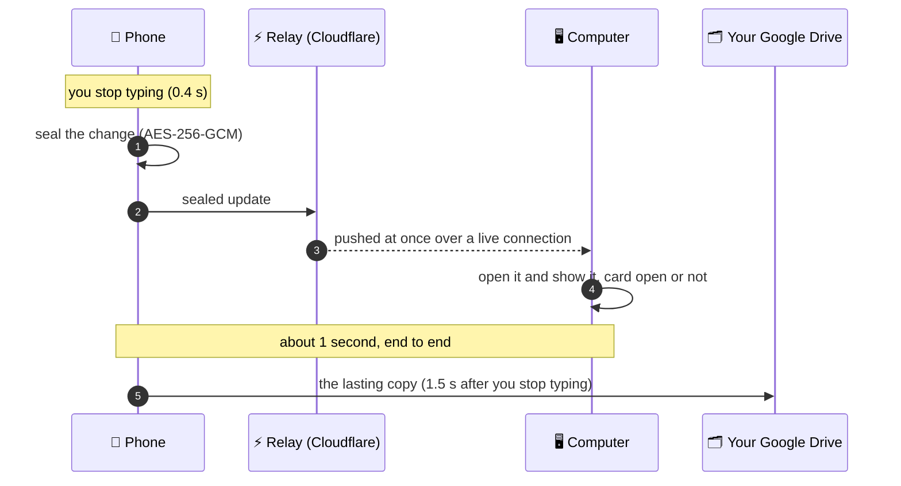

<h1 align="center">
  <br>
  Scratchy
</h1>

<p align="center">
  Quick notes that open <b>over whatever you are doing</b>, on your phone and on your desktop,<br>
  and <b>sync between them in about a second</b>, end-to-end encrypted.
</p>

<p align="center">
  
  
  
  
  
  
</p>

<p align="center">
  <a href="#sync">Sync in a second</a> ·
  <a href="#features">Features</a> ·
  <a href="#desktop">Desktop</a> ·
  <a href="#install">Install</a> ·
  <a href="docs/DEVELOPMENT.md">Developer notes</a>
</p>

<table>
  <tr>
    <td width="33%"><br><sub><b>The edge bar.</b> The thin line on the screen's edge, on top of any app.</sub></td>
    <td width="33%"><br><sub><b>The card.</b> Opens over the screen with your last note ready, glass blur behind it.</sub></td>
    <td width="33%"><br><sub><b>Screenshots.</b> Take one and the card asks where it goes.</sub></td>
  </tr>
  <tr>
    <td width="33%"><br><sub><b>Your notes.</b> A grid of cards with category chips on top.</sub></td>
    <td width="33%"><br><sub><b>Screenshot waiting.</b> The bar turns green until you file it.</sub></td>
    <td width="33%"><br><sub><b>Sync.</b> Encrypted on your device, stored in your own Google Drive.</sub></td>
  </tr>
</table>

<p align="center">
  <b>⚡ Type on your phone. It is on your computer before you look up.</b><br>
  <sub>Every edit reaches your other devices in about a second, even while their card is open, sealed with AES-256 the whole way.</sub>
</p>

## 💡 Why it exists

An idea shows up while you are watching a video, reading, or in the middle of a chat. Opening a notes app means leaving all of that, and by the time you are back the thought is gone. Scratchy puts the note **on top of what you are doing**, then gets out of the way.

<a id="sync"></a>

## ⚡ Sync in about a second

Most note apps sync when they get around to it. Scratchy sends each edit the moment you pause: **0.4 seconds after your last keystroke** it is on its way, and your other devices show it about a second later, even if that note is open on screen right now.



- **Live, not polling.** Every device keeps one connection open to a tiny Cloudflare Worker. An update is pushed the instant it arrives, so nothing waits for a timer.
- **The relay never sees your notes.** It only passes sealed messages along and keeps none of your notes. Each note is encrypted on your device with **AES-256-GCM**, using a key derived from your vault password (PBKDF2, 120,000 rounds).
- **Drive is the safety net.** Your Google Drive keeps the lasting, encrypted copy in a private app folder, saved 1.5 seconds after you stop typing. A full catch-up runs every 15 minutes and whenever you come back to the app, so a device that was off or offline gets everything.
- **No lost edits.** Each note is its own file. Different lines changed on two devices are merged line by line; the same line changed on both keeps the newer edit and saves the other as a "(conflict)" note. Nothing is overwritten silently, and a device with a wrong clock cannot win.
- **Offline is normal.** Write on a plane and everything catches up when you are back. Deleted notes stay deleted.
- **Change the vault password** and everything is re-encrypted for you.

<a id="features"></a>

## 📍 Capture without leaving

- **An edge bar that is always there.** A thin line on the left or right edge of the phone's screen, above every app, even a fullscreen video. Choose the side and how far from the edge it sits. It tucks away when you are not using it.
- **A tap or a swipe opens the card**, with a genie animation that pulls the note out of the bar and sucks it back in when you close it. Prefer a plain slide, or nothing at all? One setting.
- **The card is a real window.** Drag it anywhere, resize it, and choose a solid or liquid-glass look with your own opacity and blur.
- **Pin it** and it stays on screen while you keep using the phone: copy from a page, glance at the card, paste.
- **It remembers.** The card opens on the note you were writing, on one permanent scratch note, or on a fresh one. You choose.
- **Screenshots file themselves.** The bar turns green the moment you take one. Open the card and add it to the current note, a new note, or any other note. Or let it attach on its own.
- **A full editor, over any app.** Images in the note, paste from the clipboard (keyboard images included), and its own copy, cut and paste bar, because an overlay window cannot show Android's text menu.

## ✍️ A rich editor, no symbols in sight

Nobody has to know markdown. You format with buttons, and the note is still saved as plain markdown underneath, so it pastes cleanly into ChatGPT, Notion or Obsidian.

- **The Aa panel.** One button opens large, labelled tiles: **Bold, Italic, Strike, Code, Link**, three **heading** sizes, **Bullets, Numbers, Checklist, Quote**, **Table**, and **Indent / Outdent**. The tile lights up for whatever your cursor is in, and the panel never takes the keyboard or your selection.
- **Real tables.** Drawn as an actual grid with a tinted header and cells that wrap. Tap one to edit cells, add or remove rows and columns, or delete it.
- **Real lists.** Checkboxes you tap. Bullets and numbers continue on Enter, end on an empty line, and nest with Indent.
- **Notion-style shortcuts.** Type `- `, `1. `, `# `, `> ` or `[] ` at the start of a line.
- **Paste from any AI app.** Headings, bold, lists, links and tables arrive already formatted, with no stray symbols.
- **Format with AI.** One button turns plain text into a structured note, and **your words stay exactly as they are**: every letter of the answer is checked against your original, and an answer that changed anything is thrown away and tried again. One tap undoes it.
- **Right-to-left done properly.** Arabic lines get their bullets, numbers and checkboxes on the right, and mixed Arabic and English notes just work.
- **Old notes stay untouched.** A note you only open and close is never rewritten.

## 🗂️ Organize

- **A card-style grid**, pinned notes first, with image previews and instant search across titles, text and categories.
- **Categories without the chore.** File notes by hand, or tap **✦ Sort with AI** and every uncategorized note is filed at once, with new categories made where none fit.
- **Quiet suggestions.** After you pause typing, a small chip offers a category. Tap to accept, or ignore it and it fades. It can be switched off.
- **AI titles on demand.** Three options in the language you wrote in, reading the text and the first image.
- **Delete with undo.** No "are you sure" for every note, just a bar that lets you take it back.

## 🔒 Private by design

- **A vault with no door in sight.** Nothing on screen hints it exists. On the phone, pull the list down a long way until a lock appears; on the desktop, press Ctrl+Shift+L. Secret notes are left out of every list, search, the card and the screenshot picker.
- **Password, and fingerprint on the phone.** Secret notes are encrypted on the device, and on the phone screenshots and the recent-apps preview are blocked on those screens.
- **No account, no ads, no tracking.** Nothing leaves your device unless you turn on sync or ask for an AI feature. AI only ever sees the note you asked about, sent to OpenRouter with a key you paste in yourself.
- **No back door.** If you forget the vault password, the synced copy cannot be recovered.

<a id="desktop"></a>

## 🖥️ On your desktop too

The desktop app brings the same card to your computer. A shortcut opens it over whatever you are doing, even a fullscreen video, and it shares the phone's notes and vault: **write on one, and the other has it a second later.** Linux comes first; Windows and macOS are planned.

| | 📱 Phone | 🖥️ Desktop |
| --- | --- | --- |
| **Open the card** | Tap or swipe the edge bar | **Super+Alt+N** from anywhere, or the tray icon |
| **Close it** | Tap outside, the Close strip, or the bar again | Esc, a click beside it, the Close strip, or the shortcut again |
| **Animation** | Genie, slide or none | Genie, slide (with or without fade) or none, with a speed setting |
| **Look** | Material You colors, solid or liquid glass | Your desktop's accent color; a see-through card with blur only under it (Hyprland) |
| **Screenshots** | The bar turns green | The tray icon turns green; copied images count too |
| **Secret notes** | Pull down the list | Ctrl+Shift+L in the notes window |
| **Sync** | About a second, live | About a second, live, the same notes and vault |
| **Keys** | Android Keystore | The system keyring |

Also on the desktop: zoom with Ctrl+= and Ctrl+- (the card zooms its text and keeps its size); images by paste, drop or the Paste button; an image viewer that saves to Downloads; the full editor and Aa panel; start at login into the tray; and a notes window that is always ready.

<a id="install"></a>

## 📲 Install

### Android

Not on the Play Store. Build it and install it over USB (JDK 17+, Android SDK, a phone with USB debugging):

```bash
./gradlew assembleRelease
adb install -r app/build/outputs/apk/release/app-release.apk
```

On first run, allow "Display over other apps" and photo access, then switch the edge bar on from the notes screen.

### Desktop (Arch Linux)

Build the package from this checkout and install it (Rust, Node.js and pnpm needed):

```bash
cd desktop
pnpm install
cd packaging/arch
makepkg -f
sudo pacman -U scratchy-*.pkg.tar.zst
```

Start **Scratchy** from your launcher, then add the shortcut to your Hyprland config. Settings in the app shows this line with a Copy button:

```
bind = SUPER ALT, N, exec, scratchy-toggle
```

The card is a layer-shell surface, which is what lets it cover fullscreen apps. It is tested on Hyprland (Omarchy). Sway and KDE should work, since they have layer-shell too; GNOME isn't supported yet.

### Sync

Sync needs a free Google Cloud project, and the instant updates a free Cloudflare Worker; the steps are in the [developer notes](docs/DEVELOPMENT.md#setting-up-sync). For the desktop, put the project's desktop client in `desktop/.env.local` before building:

```
GOOGLE_CLIENT_ID=…
GOOGLE_CLIENT_SECRET=…
```

## ⚙️ Settings on the phone

A short menu with one small page per topic, and an *Advanced* fold for the rare stuff. The desktop's Settings follow the same layout, with a Shortcut page in place of the edge bar.

| Page | What you can change |
| --- | --- |
| 📍 **Edge bar** | Left or right side, and the distance from the edge (0 to 24 dp) for screen protectors that cover it. Or long-press the bar and drag it. |
| ✏️ **Card** | What the card opens on: **Recent** (the last note, if you touched it in the last 30 minutes), **Last** (always the last note), **Scratch** (one permanent pinned note) or **New** (always blank). |
| 🎨 **Appearance** | **Color:** follow the wallpaper, or a fixed blue, orange, teal, green or purple. **Style:** Solid or Liquid glass, with a live preview. **Opacity** 30 to 100%, **blur** 0 to 100%. **Opening and closing:** Genie, Slide or None, and the genie's speed. |
| 📸 **Screenshots** | **Ask**, **Auto-attach** or **Off**. *Advanced:* how long a waiting screenshot is kept, from 15 seconds to 5 minutes. |
| 🔄 **Sync** | Connect Google Drive, **Sync now**, disconnect, see the status, and enter the new vault password after changing it on another device. |
| 🔒 **Secret notes** | Change the vault password; everything in Drive is re-encrypted. |
| ✨ **AI** | **Category suggestions** on or off, your **OpenRouter key** with a connection test, and under *Advanced* the text and image models. |

## 🧰 How it is built

| | |
| --- | --- |
| [`app/`](app) | The Android app: plain Kotlin and Android Views, no Compose and no XML layouts. About 8,200 lines, with the merge engine and markdown logic covered by 45 unit tests. |
| [`desktop/`](desktop) | The desktop app: Tauri 2, Svelte and TypeScript, with a small Rust side for the overlay, tray, keyring and screenshot watching. Its core (sync, merge, encryption, markdown) is tested against the phone's formats with 123 tests. |
| [`worker/`](worker) | The Cloudflare Worker that relays sealed updates between devices. |
| [`docs/`](docs) | [Developer notes](docs/DEVELOPMENT.md): how sync works, the code map, and setting up Google Drive and the relay. |

The sync format is versioned and shared by both apps: a note written on one reads the same on the other, and opening it never rewrites it.

## 📜 License

Scratchy is free software under the [GNU General Public License v3.0 or later](LICENSE). You can use, study, change and share it; if you share a changed version, share its source under the same license.

Copyright © 2026 Milad Halabi
