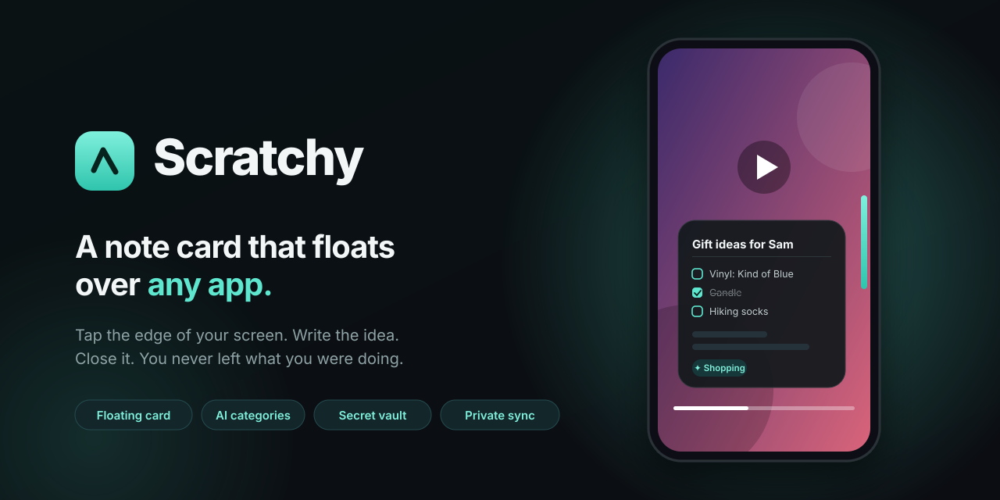
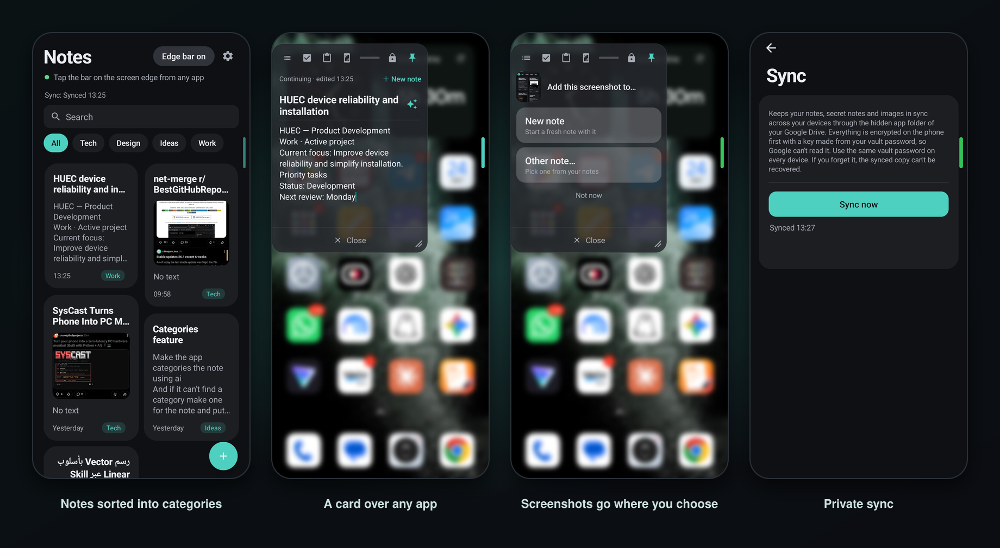
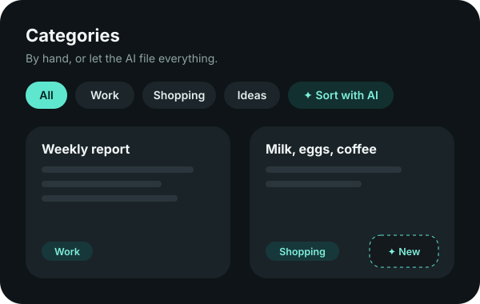
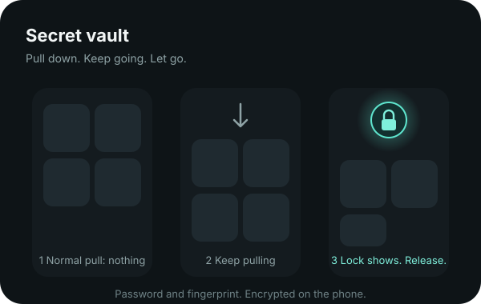
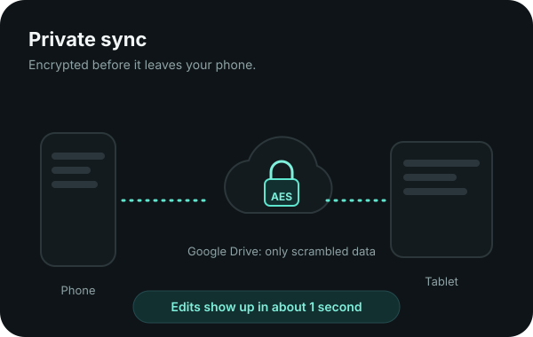
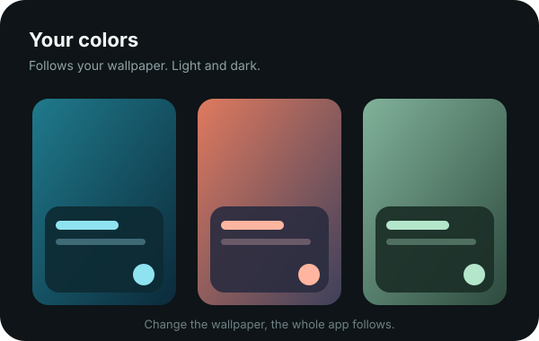

<p align="center">
  
</p>

<p align="center">
  <b>Tap the edge of your screen. Write the idea. Close it.</b><br>
  A personal Android notes app: fast first, private second.
</p>

<p align="center">
  
  
  
  
</p>

<p align="center">
  <a href="#why">Why</a> ·
  <a href="#the-app">The app</a> ·
  <a href="#features">Features</a> ·
  <a href="#privacy">Privacy</a> ·
  <a href="#install">Install</a> ·
  <a href="docs/DEVELOPMENT.md">Developer notes</a>
</p>

---

## Why

You are watching a video, reading an article, in the middle of a chat, and an idea shows up. Opening a notes app means leaving everything else, and by the time you are back, the thought is gone.

Scratchy keeps a thin bar on the edge of your screen. Tap it and a note card opens **right on top of what you are doing**. Type, close, carry on. You never left the app.

## The app

<p align="center">
  
</p>

<sub>Real screenshots, taken on the phone it was built for.</sub>

## How it feels

<table>
  <tr>
    <td width="33%" valign="top"><h4>1 · Tap the edge</h4>The bar is always there, thin enough to forget. Tap or swipe it from any app.</td>
    <td width="33%" valign="top"><h4>2 · Write it down</h4>The card opens over what you are doing, with your last note ready to continue, or a fresh one.</td>
    <td width="33%" valign="top"><h4>3 · Carry on</h4>Close it and the card shrinks back into the bar. Later, the idea is filed and synced.</td>
  </tr>
</table>

## Features

<table>
  <tr>
    <td width="50%"></td>
    <td width="50%"></td>
  </tr>
  <tr>
    <td width="50%"></td>
    <td width="50%"></td>
  </tr>
</table>

### Capture without leaving where you are
- A slim bar on the left or right edge. Tap or swipe it and the card opens with a small genie animation, then shrinks back into the bar when you close it.
- Drag it, resize it, make it see-through or glassy, or **pin** it so it stays while you use the phone.
- Take a screenshot and the bar changes color. Open the card and Scratchy asks where it goes: the current note, a new one, or another note.

### Notes that are nice to live in
- A two-column grid of cards, pinned notes first, big image previews, instant search.
- Checklists, pictures inside notes, paste from the clipboard.
- Hold a note to delete it. Changed your mind? Undo.
- Colors follow your wallpaper (Material You), light and dark. Prefer one fixed color? Pick it in Settings.
- Dialogs are the app's own: rounded, in your colors, no system gray boxes.

### Categories that mostly sort themselves
- File a note by hand, or tap **✦ Sort with AI** and every uncategorized note is filed for you. A note that fits nothing gets a new category of its own.
- While you write a new note, a small chip quietly suggests a category. Tap to accept, ignore it and it fades. No popups, and you can turn it off in Settings.
- One tap on a category chip filters the whole list. Hold a chip to rename or remove it.

### Titles from AI, only when you ask
- Tap the sparkle next to a title for three options, from short to detailed, based on the text or the first image. Works in any language.

### A secret vault, hidden on purpose
- Pull the notes list down, slowly and a long way. Nothing shows at first. Keep going and a lock appears with a small buzz. Let go and the vault opens. A normal scroll never triggers it.
- Password plus fingerprint. Secret notes vanish from every list, search, the card and the screenshot picker. They are encrypted on the phone, and screenshots are blocked on those screens.

### Sync across your devices, privately
- Connect Google Drive and your notes appear on your other phone or tablet. Everything is encrypted on your device, with a key made from your vault password, before it leaves. Drive only ever holds scrambled data.
- Edits show up on the other device in about a second.
- Two devices edit the same note? Changes to different lines are merged. If the same line changed on both, nothing is lost: one version stays and the other is saved as a "(conflict)" copy.
- Works offline and catches up when it can.

## Privacy

- Your notes live in the app's private storage on your phone.
- Nothing is sent anywhere unless you turn on sync or use an AI feature.
- AI features send only the note you asked about (or the notes being sorted), only when you tap, to OpenRouter, with a key you paste in yourself.
- Synced data is end-to-end encrypted. **If you forget the vault password, the synced copy cannot be recovered.** There is no reset.

## Install

Scratchy is not on the Play Store yet. You build it and install it over USB (JDK 17+, the Android SDK, and a phone with USB debugging):

```bash
./gradlew assembleRelease
adb install -r app/build/outputs/apk/release/app-release.apk
```

On first run, allow "Display over other apps" and photo access, then switch the edge bar on from the notes screen.

Want sync? You need a free Google Cloud project for Drive access and, optionally, a free Cloudflare Worker for the instant updates. The steps are in the [developer notes](docs/DEVELOPMENT.md#setting-up-sync).

## Built with

Kotlin and plain Android Views (no Compose, no XML layouts), springs for every animation, and a tiny Cloudflare Worker that passes encrypted updates between devices. How it all fits together, the code map and what is still to polish live in [docs/DEVELOPMENT.md](docs/DEVELOPMENT.md).

<p align="center"><sub>Made for one person's phone, shared in case it is useful to yours.</sub></p>
