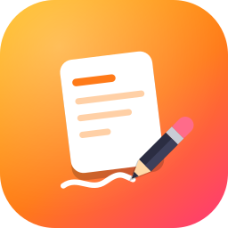
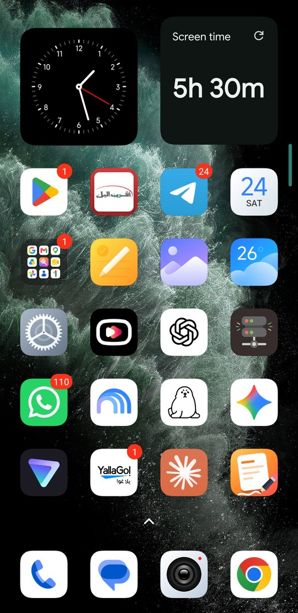
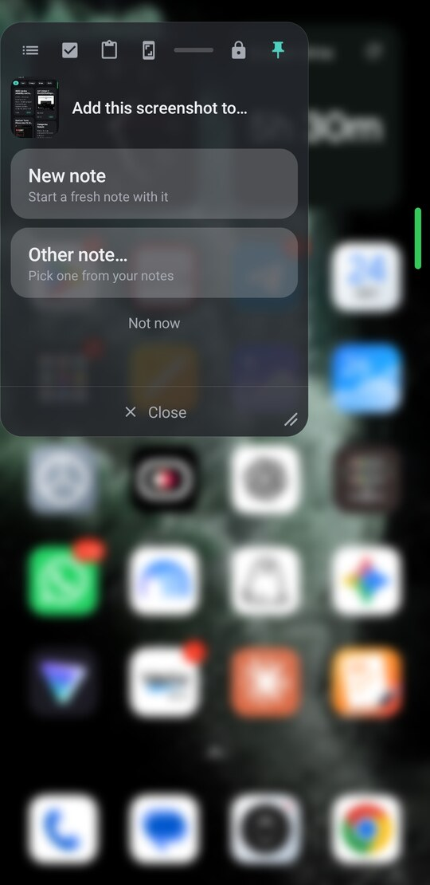
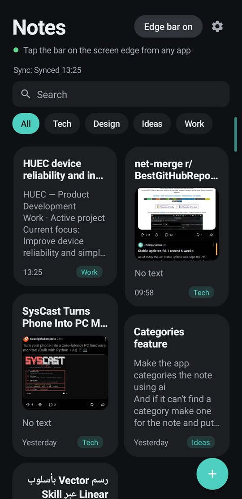
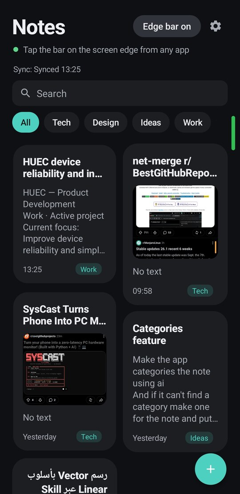
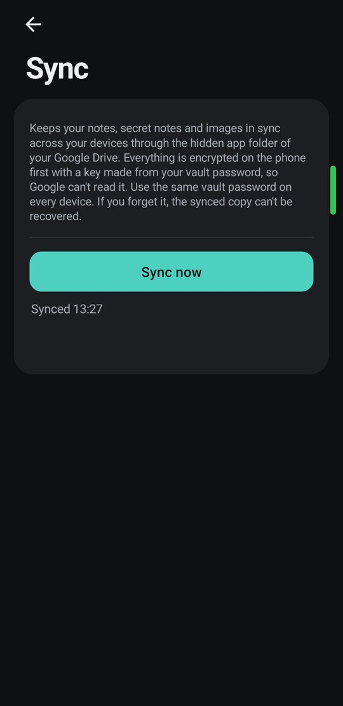

<h1 align="center">
  <br>
  Scratchy
</h1>

<p align="center">
  A quick-note app for Android that opens a note card <b>over whatever you are doing</b>.<br>
  Tap the edge of the screen, write the idea, close it. You never left the app.
</p>

<table>
  <tr>
    <td width="33%"><br><sub><b>The edge bar.</b> The thin teal line on the right edge, on top of any app.</sub></td>
    <td width="33%"><br><sub><b>The card.</b> Opens over the screen with your last note ready, glass blur behind it.</sub></td>
    <td width="33%"><br><sub><b>Screenshots.</b> Take one and the card asks where it goes.</sub></td>
  </tr>
  <tr>
    <td width="33%"><br><sub><b>Your notes.</b> A grid of cards with category chips on top.</sub></td>
    <td width="33%"><br><sub><b>Screenshot waiting.</b> The bar turns green until you file it.</sub></td>
    <td width="33%"><br><sub><b>Sync.</b> Encrypted on the phone, stored in your own Google Drive.</sub></td>
  </tr>
</table>

## 💡 Why it exists

An idea shows up while you are watching a video, reading, or mid-chat. Opening a notes app means leaving everything, and by the time you are back, the thought is gone. Scratchy puts the note **on top of what you are doing**, then gets out of your way.

## ⚡ Capture, without leaving where you are

- 📍 **An edge bar that is always there.** A thin line on the left or right edge of the screen, on top of every app, even a fullscreen video. Choose the side and how far from the edge it sits. It tucks away when you are not using it.
- 🧞 **Tap or swipe it and the card opens** with a genie animation, as if the note is pulled out of the bar. Close it and it is sucked back in. Prefer a plain slide, or nothing? One setting.
- 🪟 **The card is a real window.** Drag it anywhere, resize it from the corner, change its opacity and blur, pick a solid or liquid-glass look.
- 📌 **Pin it** and the card stays on screen while you carry on using the phone: copy from a page, glance at the card, paste.
- 🧠 **It remembers.** The card opens on your last note ready to continue, on one permanent scratch note, or on a fresh one. You choose.
- 📸 **Screenshot? One tap to file it.** The bar turns green the moment you take one. Open the card and choose: add to the current note, start a new note, or pick another note. Or let it attach on its own.
- ✍️ **Markdown, all the way down.** Notes *are* markdown: paste an answer from ChatGPT, Claude or any AI app and it just works. Headings, **bold**, *italics*, `code`, fenced code blocks, quotes, links, tables and rules are drawn as you type (the symbols stay, dimmed, so you can still edit them), and everywhere else, the grid, the card, the previews, they read clean with the symbols hidden. What you copy out is the same markdown you pasted in.
- ✨ **Format with AI.** Paste or type plain text, tap the **✨ Format with AI** button in the note screen, and it becomes headings, lists, checklists, bold and tables, with **your words exactly as they were**. The app checks every word of the result against your original and throws the AI's answer away if a single word changed. One tap to undo. It only runs in the app, never in the floating card.
- ☑️ **Real lists.** `- [ ]` checklists show as checkboxes you tap, bullets and numbered lists continue on Enter and end on an empty line, and Backspace removes a whole list marker in one go. Your old checklist notes convert themselves.
- 📋 **A real editor, over any app.** Images inside the note, paste from the clipboard (including images from the keyboard), and its own copy, cut and paste bar, because an overlay window cannot show Android's text menu.
## 🗂️ Organize

- 🧱 **A card-style notes grid** with pinned notes first, big image previews cropped from the middle, and instant search across titles, text and categories.
- 🏷️ **Categories you do not have to think about.** File a note by hand, or tap **✦ Sort with AI** and every uncategorized note is filed in one go. If a note fits none of your categories, it gets a brand new one. Filter the whole list with one tap, hold a chip to rename or remove it.
- 🤫 **Suggestions while you write.** A small chip offers a category after you pause typing. Accept with a tap, ignore it and it fades. It never pops up, never steals focus, and can be switched off.
- ✨ **AI titles on demand.** Tap the sparkle for three options, from three words to a full descriptive line. It reads the text, and the first image too, and answers in the language you wrote in.
- 🗑️ **Hold to delete, with undo.** No "are you sure" for every note, just a bar that lets you take it back.

## 🔒 Keep it private

- 🕳️ **A vault with no door in sight.** Nothing on screen hints it exists. Pull the notes list down a long way, a lock appears with a haptic click, let go and it opens. Pull back and it disappears. A normal scroll can never open it.
- 👆 **Password and fingerprint.** Secret notes are removed from every list, search, the card and the screenshot picker. They are encrypted on the phone with a key that never leaves Android's Keystore, and screenshots and the recent-apps preview are blocked on those screens.
- 🙈 **Your data stays yours.** No account, no ads, no tracking. Nothing leaves the phone unless you turn on sync or ask for an AI feature, and AI only ever sees the note you asked about.

## 🔄 Sync, the way it should work

- ⚡ **Instant across devices.** Edit on your phone and the note changes on your tablet in about **a second**, even while its card is open. A small Cloudflare Worker relays the update, and it stores nothing: it only passes sealed messages along.
- 🔐 **Encrypted before it leaves.** Every note is sealed on your device with **AES-256-GCM**, with a key derived from your vault password (PBKDF2, 120,000 rounds). Google Drive holds only scrambled files in your private app folder, and the relay only ever sees ciphertext. Secret notes sync too.
- 🛡️ **No lost edits, ever.** Each note is its own file. Two devices change different lines of the same note? They are merged line by line. Same line changed on both? The newer edit stays and the other is saved as a "(conflict)" note. Nothing is overwritten silently, and a phone with a wrong clock cannot win.
- ✈️ **Offline is normal.** Write on a plane, and the devices catch up when you are back. A background sync runs every 15 minutes, there is a status line on the notes screen, and deleted notes stay deleted.
- 🔑 **Change your vault password** and everything is re-encrypted for you.

## 🎨 It looks like your phone

- 🖼️ **Material You.** The whole app takes its colors from your wallpaper, light and dark. Change the wallpaper and the app follows. Prefer one fixed color? Choose it in Settings.
- 🌊 **Springs, not stock animations.** Every movement is interruptible and carries your finger's velocity, from the card to the delete bar.
- 💬 **Its own dialogs.** Rounded cards in your colors, not the gray system boxes.

## ⚙️ Settings

A short menu with one small page per topic, and an *Advanced* fold for the rare stuff.

| Page | What you can change |
| --- | --- |
| 📍 **Edge bar** | Left or right side. Distance from the edge (0 to 24 dp), for screen protectors that cover it. Or long-press the bar and drag it. |
| ✏️ **Card** | What the card opens on: **Recent** (continue the last note if you touched it in the last 30 minutes), **Last** (always continue it), **Scratch** (one permanent pinned note) or **New** (always blank). |
| 🎨 **Appearance** | **Color:** follow the wallpaper, or pick a fixed one (blue, orange, teal, green, purple). **Style:** Solid or Liquid glass, with a live preview. **Opacity** 30 to 100%. **Blur** behind the card 0 to 100%. **Opening and closing:** Genie, Slide or None, and **genie speed** 50 to 200%. |
| 📸 **Screenshots** | **Ask** (the bar turns green and the card asks where it goes), **Auto-attach**, or **Off**. *Advanced:* forget a waiting screenshot after 15 s, 30 s, 1, 2 or 5 min. |
| 🔄 **Sync** | Connect Google Drive, **Sync now**, disconnect, see the status, and enter a new vault password after changing it on another device. |
| 🔒 **Secret notes** | Change the vault password (everything in Drive is re-encrypted). |
| ✨ **AI** | Turn **category suggestions** on or off. Paste your **OpenRouter key** and test the connection. *Advanced:* the text model and the image model. |

## 🧰 Built to last

Plain Kotlin and Android Views, no Compose and no XML layouts. The merge engine and the markdown logic are pure Kotlin with 34 unit tests, and the sync format is versioned. About 6,000 lines.

## 🔏 Privacy

- Notes live in the app's private storage.
- AI features send only the note you asked about (or the notes being sorted), only when you tap, to OpenRouter, with a key you paste in yourself.
- If you forget the vault password, the synced copy cannot be recovered. There is no reset.

## 📲 Install

Not on the Play Store. Build it and install it over USB (JDK 17+, Android SDK, a phone with USB debugging):

```bash
./gradlew assembleRelease
adb install -r app/build/outputs/apk/release/app-release.apk
```

On first run, allow "Display over other apps" and photo access, then switch the edge bar on from the notes screen. Sync needs a free Google Cloud project, and the instant updates need a free Cloudflare Worker. The steps are in the [developer notes](docs/DEVELOPMENT.md#setting-up-sync).

Kotlin, plain Android Views, Android 8.0 and up. How it works inside is in [docs/DEVELOPMENT.md](docs/DEVELOPMENT.md).
